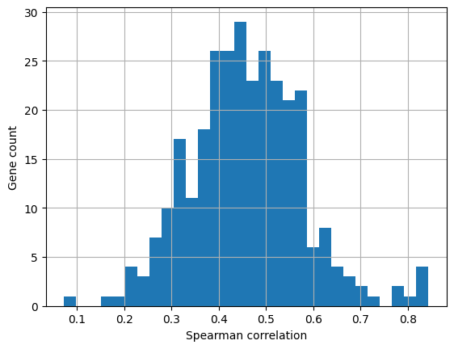
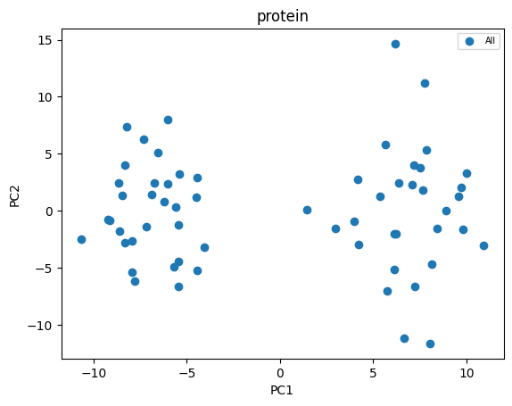

# OmicsMarker

OmicsMarker asks two questions about breast tumours. **When a gene has more RNA in one sample than another, does its protein tend to be more abundant too? How well can RNA, protein, or the two together predict a tumour label in held-out samples?** The workflow pairs measurements from the same sample, calculates a correlation for each shared gene, then compares XGBoost and TensorFlow classifiers. It produces an offline HTML report, figures, reusable data tables, predictions, and saved models.

**Start with the synthetic example below.** It generates all its data locally and runs the complete analysis for one label, ER (estrogen receptor status). Once that works, the [public breast tumour cohort walkthrough](#run-the-public-breast-tumour-cohort) uses the same commands with study data.

## See the data and figures before running anything

Each row below represents one artificial sample. The two measurements come from different assays of the same gene. ER is the generated class label, and NA is a missing measurement handled during preparation. Values are in synthetic assay units.

| Sample | ER | RNA for GENE000 | Protein for GENE000 |
|---|---:|---:|---:|
| S000 | 0 | 0.3562 | NA |
| S001 | 1 | 3.5425 | 3.0336 |
| S002 | 0 | −1.5416 | 0.1678 |

[Download the paired sample excerpt](docs/example/paired-samples.tsv) · [Inspect all 300 gene correlations](docs/example/correlation.tsv)



**Figure 1. RNA–protein agreement.** For each gene, samples are ranked once by RNA and once by protein. A correlation near +1 means their rankings largely agree. The horizontal axis is that correlation and the vertical axis counts genes. The median in this example is **0.454**. The generator gives both assays a shared signal, so this value describes the simulation.



**Figure 2. Sample quality control.** Each point is one sample, positioned using the first two principal components of the prepared protein matrix. Look for isolated samples or groups worth investigating. The demo has one plotting group, “All”. With the public cohort, the colours identify measurement batches (TMT plexes).

## 1. Get the code and install the tools

Use a Linux terminal with Git, Bash, Python **3.11 or 3.12**, and Python's venv module. Windows users can run the Bash commands in an Ubuntu WSL terminal. You need internet access for the clone and package installation. The demo runs on CPU and generates its own inputs. Docker, a database, and a patient dataset are optional.

Run these commands in order. Use the same terminal for the remaining steps. If your interpreter is named `python3.12`, use that in place of `python3.11`.

```bash
git clone https://github.com/anjalianjali1234/omicsmarker.git
cd omicsmarker
python3.11 -m venv .venv
source .venv/bin/activate
python -m pip install -e '.[analysis]' pytest
omicsmarker --help
python -m pytest -q tests
```

The help output lists commands including `synthetic`, `prepare`, and `train`. The repository has three unit tests. If a new terminal says “omicsmarker: command not found”, return to the cloned folder and run `source .venv/bin/activate`.

## 2. Generate the example data

Run every block from the repository root. Use a fresh output folder for each experiment so that old results cannot mix with new ones.

```bash
RUN=runs/demo
export TF_NUM_INTRAOP_THREADS=1 TF_NUM_INTEROP_THREADS=1 OMP_NUM_THREADS=1
omicsmarker synthetic --seed 42 --out "$RUN/input"
```

This creates 60 samples, two equally sized ER classes and 300 genes per assay. Ten genes carry an artificial class signal. Each input is a Parquet table, a binary format that preserves row identifiers and numeric types.

| File under `runs/demo/input/` | Rows and columns |
|---|---|
| `transcriptomics.parquet` | Samples × genes, RNA measurements |
| `proteomics.parquet` | Samples × genes, protein measurements with some missing entries |
| `clinical.parquet` | Same sample IDs, with sample type and ER label |

## 3. Match samples and check the measurements

```bash
omicsmarker prepare --data "$RUN/input" --config config/test.yaml --out "$RUN/ready"
python - <<'PY'
import pandas as pd
for name in ("rna", "protein", "labels"):
    table = pd.read_parquet(f"runs/demo/ready/{name}.parquet")
    print(name, table.shape)
PY
```

Expect `rna (60, 300)`, `protein (60, 300)`, and `labels (60, 1)`. Preparation keeps tumour IDs present in both assays and the label table, removes proteins observed in fewer than half the samples, and fills remaining missing protein values using each sample's abundance distribution. Open `ready/rna_pca.png` and `ready/protein_pca.png` inside the run folder to inspect sample structure.

## 4. Measure RNA–protein agreement

```bash
omicsmarker integrate --data "$RUN/ready" --out "$RUN/integration"
head -n 6 "$RUN/integration/correlation.tsv"
```

The table contains the gene symbol, Spearman rank correlation (`rho`), and its unadjusted p-value (`p`). The rows are sorted from lowest to highest correlation. The accompanying `correlation.png` is Figure 1 above.

## 5. Train and evaluate the models

```bash
omicsmarker train --data "$RUN/ready" --config config/test.yaml \
  --target ER --git-commit "$(git rev-parse HEAD)" --out "$RUN/train"
```

For each of three input sets (RNA, protein, and combined), the command trains both model types. The demo uses two inner folds to score candidate settings and three outer folds to estimate performance on held-out samples. Feature selection and scaling are fitted on training partitions. Initial missingness filtering uses the full cohort. The command writes results after fitting, so allow it to finish before building the report.

## 6. Build the report and check the result

```bash
omicsmarker report --analysis "$RUN/integration" \
  --records "$RUN/train/run_record.json" --predictions "$RUN/train/predictions.json" \
  --out "$RUN/report.html"
```

Open **runs/demo/report.html** in a browser. To see the saved example without installing Python, download [example-report.html](docs/example-report.html) using GitHub's **Download raw file** button, then open the downloaded file.

| Output inside the run folder | What to look for |
|---|---|
| `report.html` | Class counts, correlation histogram, performance table, held-out ROC curves, SHAP feature rankings and run details |
| `train/predictions.json` | One held-out prediction per sample per assay/model combination. The class order for the probability array is in the run record. |
| `train/run_record.json` | Seed, versions, Git revision, class counts, excluded classes, fold scores, selected settings, feature rankings and artifact checksums |
| `train/*.keras`, XGBoost model JSON and `*-scale.json` | Fold-specific models, selected feature names and scaling parameters |

**How to read the scores.** AUROC measures how well scores rank the two classes. Balanced accuracy averages recall across classes. In the saved demo, combined-assay XGBoost reached mean AUROC **0.997** and balanced accuracy **0.950** across the three folds. The classes were deliberately easy to distinguish. These results verify signal recovery in artificial data. The SHAP bars show which features influenced a model's predictions. Clinical interpretation requires independent validation. [See all six example results](docs/results.md).

**Repeat the whole demo with one command.** After setup, the repository's smoke test performs steps 2–6. Give it a new folder to keep both runs. Save the installed versions if you want to compare environments later.

```bash
bash tests/smoke.sh runs/demo-repeat
python -m pip freeze > runs/demo-repeat/python-packages.txt
```

## Run the public breast tumour cohort

Use this route to study matched human tumours. It downloads Broad RNA, UMich proteomics and MSSM clinical sample identifiers via CPTAC, then joins the study's cBioPortal annotations for ER, PR (progesterone receptor), HER2 and PAM50 molecular subtype. Download access and upstream file versions affect this route. The synthetic example above is the end-to-end verified run.

From the same activated environment and repository root:

```bash
python -m pip install -e '.[analysis,data]'
DATA="$HOME/om_data/omicsmarker"
omicsmarker fetch --out "$DATA/input"
omicsmarker prepare --data "$DATA/input" --config config/run.yaml --out "$DATA/ready"
omicsmarker integrate --data "$DATA/ready" --out "$DATA/integration"
```

Inspect the label counts before selecting a target. This configuration keeps classes with at least ten labelled samples and uses five outer folds and three inner folds. Check the batch-coloured PCA plots as well.

```bash
python - "$DATA/ready/labels.parquet" <<'PY'
import sys
import pandas as pd
for target, labels in pd.read_parquet(sys.argv[1]).items():
    print(target, labels.value_counts(dropna=False).to_dict())
PY
```

Start with ER. The full configuration searches more settings than the demo and takes longer. To analyse another supported target, set TARGET to PR, HER2 or PAM50 and repeat the block. Each target gets its own output folder.

```bash
TARGET=ER
omicsmarker train --data "$DATA/ready" --config config/run.yaml \
  --target "$TARGET" --git-commit "$(git rev-parse HEAD)" --out "$DATA/train/$TARGET"
omicsmarker report --analysis "$DATA/integration" \
  --records "$DATA/train/$TARGET/run_record.json" \
  --predictions "$DATA/train/$TARGET/predictions.json" --out "$DATA/report-$TARGET.html"
```

Keep `input/sources.json`, the run record, and the configuration with the report. A checksum error during fetch means the upstream annotation differs from the expected version. Review the changed source before using that export. A “Review … classes” error means the retained labels cannot support that classification task. Inspect the counts and label mapping. [Study sources, access details and historical cohort counts](docs/data.md).

## Optional workflow engines and raw spectra

The command-line tutorial above works independently of a workflow engine. To use the WDL version of the synthetic run, first complete step 2 with its default output folder, install Docker with a miniwdl-compatible runner, and run from the repository root:

```bash
python -m pip install miniwdl cwltool
docker build -f docker/analysis.Dockerfile -t omicsmarker-analysis:dev .
miniwdl check wdl/omicsmarker.wdl
miniwdl run wdl/omicsmarker.wdl -i wdl/inputs/test.json --dir runs/wdl
cwltool --validate cwl/sage_search.cwl
```

For Cromwell, supply a configured Docker backend and run `java -jar "$CROMWELL_JAR" run wdl/omicsmarker.wdl -i wdl/inputs/test.json`. For cohort runs, edit [full.json](wdl/inputs/full.json) to point to the exported tables, configuration and actual Git revision. WDL and CWL syntax validation are included in CI.

The optional raw-search branch searches independent PRIDE breast cancer cell-line spectra with Sage and compares gene-level abundance ranks with the tumour cohort. The studies share gene symbols but have different samples. Build the image with `docker build -f docker/proteomics.Dockerfile -t omicsmarker-proteomics:dev .`, set `omicsmarker.run_raw_search` to true in the WDL inputs and supply `omicsmarker.raw_files`, `omicsmarker.fasta`, and `omicsmarker.sage_config`. Outputs include a protein matrix and per-file search QC. The standalone CWL search instead accepts mzML files. [Raw data and reference FASTA sources](docs/data.md).

For optional Hallmark enrichment, supply a local GMT gene-set file with `omicsmarker integrate --gmt` alongside its required arguments. For optional database tracking, set `OM_MONGO_URI` in the training environment. [MongoDB example query](docs/queries.md)

## Copyright

Copyright (c) 2026 OmicsMarker contributors. All rights reserved. Contact the repository owner for permission to reuse the original project material.
